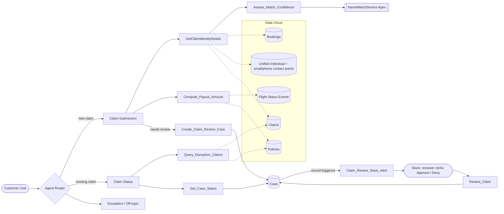

# AeroWave Claims Concierge

An **Agentforce** service agent for a fictional airline, AeroWave. Travelers use it to file a travel-disruption insurance claim, or check on one, in a single chat. It finds their booking, verifies their identity across systems, works out the payout from real flight-status data, and decides in seconds. Cases it can't safely decide go to a human reviewer, who approves or denies them **directly from Slack**.

[](https://www.youtube.com/watch?v=HHdIy_w8P9Q)

▶️ **[Watch the demo on YouTube](https://www.youtube.com/watch?v=HHdIy_w8P9Q)**

---

## The business problem

When flights are delayed or canceled, an airline's insurance desk receives a flood of claims at once. Each one needs the same manual work: find the booking, confirm the claimant is the traveler, check what actually happened to the flight, look up the policy, and calculate the payout. Customers wait days for an answer that is usually simple, and agents spend their time on the easy cases instead of the hard ones.

## What the agent does

| Customer asks to… | Agent behavior |
|---|---|
| **File a new claim** | Asks for **one** identifier (booking reference or email), then runs identity matching and payout rules and gives a definite outcome: **approved with amount**, **not eligible**, or **sent to human review with a case number**. It never asks the customer what happened to the flight, because the flight data decides that. |
| **Check an existing claim** | Looks up the claim by email, booking reference, or case number. For claims under review, it reports progress and the final decision once one is made. |
| **Talk to a person** | Escalates to a live agent. |
| **Anything else** | Politely steers back to claims and resists prompt-injection attempts. |

### Decision logic

- **Identity confidence score (0–100):** Compares the traveler's **loyalty profile** with the **booking record**. Email match = 55, phone = 30, first name = 10, postal code = 5.
  - **≥ 80** → decided automatically
  - **< 80** → a Case is created for human review
- **First-name matching** goes beyond exact equality. Custom Apex (`NameMatchService`) handles nicknames (Bob ↔ Robert), punctuation, and typos (Levenshtein distance).
- **Payout rules**, based on Data Cloud flight-status events and policy records:
  - Canceled → **$300**
  - Delayed 120+ min → **$150**
  - Delayed < 120 min or on time → **$0**
  - No flight-status record → **human review**

---

## Architecture



### Built with

| Layer | What's used |
|---|---|
| **Agent** | Agentforce (Agent Script / Agent Builder): topic routing with a hyper-classifier, deterministic `if/else` reasoning, variable-gated actions |
| **Data** | **Data Cloud:** Bookings, Claims, Policies, Flight Status Events, and identity resolution (Unified Individual, contact points), all built from **synthetic data** |
| **Automation** | Flows: 6 autolaunched agent actions, 1 record-triggered flow, 1 screen flow launched from Slack |
| **Code** | Apex invocable action for fuzzy name matching |
| **Human in the loop** | Salesforce for Slack: reviewers get an alert and decide in Slack, which updates the Case |

---

## Design choices worth noting

- **Deterministic outcomes, not LLM judgment.** Flows make the money decisions: identity score, routing, and payout amount. The LLM only handles the conversation and the order of steps.
- **No data leaks through the chat.**
  - The agent never reads stored email, phone, or postal code back to the customer.
  - It never exposes internal IDs, case statuses, or confidence scores.
  - Lookups by email or booking reference confirm only that a claim exists, never the decision or amount. Those identifiers aren't strong enough proof of who's asking.
- **Defense against enumeration.** Case numbers are sequential, so the case-number status check reports *that* a claim was approved but never the dollar amount.
- **No invented facts.** The agent only says a case exists if creating it succeeded. Each claim is judged only on values looked up in the current turn, so details from an earlier claim in the same chat can't carry over.
- **Low-friction intake.** The agent asks for one identifier and never asks the customer to describe the disruption.

---

## Known limitations & next steps

This is a demo build. Before production I would add:

1. **Claimant verification.** Today the identity score compares two *stored* records (loyalty vs. booking). It doesn't prove the person chatting is the traveler. Next step: a one-time passcode to the email or phone on file, or authenticated chat via Messaging verified-user context, before any decision is shared.
2. **Persist auto-approved claims.** Auto-approved claims currently get an answer but no record is written. Next step: write a Claim record on every decision, to trigger payout fulfillment, block duplicate claims for the same booking, and keep an audit trail.
3. **Test coverage and portability.** Add an Apex test class for `NameMatchService` (required for production deploys), and replace the hard-coded org URL and Slack IDs in the Slack alert flow with Custom Metadata.
4. **Cleanup.** Remove earlier agent versions and default site classes from the retrieved metadata.

---

## Repository layout

```
force-app/main/default/
├── aiAuthoringBundles/     # Agent Script definitions (the agent's topics, instructions, actions)
├── genAiPlannerBundles/    # Compiled planner bundles + action input/output schemas
├── bots/                   # Agent (Bot / BotVersion) configuration
├── flows/                  # Agent actions, Slack alert, Slack review flow
├── classes/                # NameMatchService (custom) + default Experience Cloud site classes
└── permissionsets/         # Agent user permissions
manifest/package.xml        # Metadata retrieved from the org
```

## Running it yourself

```bash
sf org login web --alias aerowave
sf project deploy start --manifest manifest/package.xml --target-org aerowave
```

> The org also needs Agentforce and Data Cloud enabled, with the Bookings, Claims, Policies and Flight Status Events data objects and identity resolution set up, plus Salesforce for Slack for the review step. Those are org configuration and synthetic data, not deployable source in this repo.
