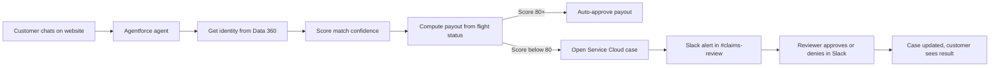

# AeroWave Claims Concierge

An Agentforce agent that settles travel-disruption insurance claims in seconds and routes the ones it can't verify to a human reviewer in Slack. Built on Data 360, Agentforce, Service Cloud, and Slack.

**Demo video:** [Watch on YouTube](https://www.youtube.com/watch?v=HHdIy_w8P9Q) · **Live site:** [pzavar.github.io/aerowave-demo](https://pzavar.github.io/aerowave-demo/)

> Aerowave Airlines is a fictional company. All customer data used in the demo is synthetic, and the datasets are not included in this repo.

---

## The problem

When a flight is canceled, insured travelers file claims. The data needed to judge one claim lives in five systems that don't talk to each other: loyalty, reservations, flight operations, policies, and claims. So every claim waits for manual review, legitimate or not. And manual review under volume is exactly when duplicate claims slip through.

Insurers can process claims fast or safely. This project shows both.

## How it works

1. A customer files a claim on the website with a booking reference or email.
2. The agent pulls the customer's unified identity from Data 360, scores how well their records agree, and checks what actually happened to the flight.
3. If the identity is clean, the agent approves the payout on the spot.
4. If it isn't, the agent opens a case with a reviewer brief it writes itself, and Slack alerts the review team.
5. The reviewer loops in fraud if needed, then approves or denies from Slack. The decision writes back to the case, and the customer's next status check reflects it.

## Architecture

| Layer | What it does |
|---|---|
| **Data 360** (formerly Data Cloud) | Ingests five source files and links each person's loyalty and booking records with identity resolution (exact email, exact phone) |
| **Agentforce** | Routes the conversation, collects one identifier, calls Flows in order, and enforces what the customer may and may not be told |
| **Flows** | Do all the math, so the same input always gives the same score and payout |
| **Apex** | `NameMatchService` handles fuzzy and nickname first-name matching (Mike and Michael) |
| **Service Cloud** | Claims Review cases with Approved and Denied statuses |
| **Slack** | Case alerts, fraud handoff, and a Slack-native approval form |
| **Website** | Static site on GitHub Pages, hosting the agent through Salesforce Enhanced Chat |

### Flows

| Flow | Purpose |
|---|---|
| `GetClaimIdentityDetails` | Resolves one identifier into paired loyalty and booking fields |
| `Assess_Match_Confidence` | Scores the identity match and returns a route |
| `Compute_Payout_Amount` | Checks flight status and returns the payout |
| `Create_Claim_Review_Case` | Creates the review case with the Claims Review record type |
| `Query_Disruption_Claims` | Looks up existing claims by email or reference |
| `Get_Case_Status` | Looks up an escalated claim by case number |
| `Claim_Review_Slack_Alert` | Posts new review cases to Slack with a Review Claim button |
| `Review_Claim` | Slack-enabled approval form that updates the case |

### Confidence scoring

| Field | Points |
|---|---|
| Email, exact match | 55 |
| Phone, exact match | 30 |
| First name, exact or fuzzy match | 10 |
| Zip, exact match | 5 |

A score of 80 or more is approved automatically. Anything lower goes to a person.

### Payout rules

| Flight status | Payout |
|---|---|
| Delayed 120+ minutes | $150 |
| Canceled | $300 |
| Delayed under 120 minutes | $0 |

## Design decisions

- **The model decides what to do, not what the numbers are.** Scores and payouts come from Flows, so they are deterministic and auditable.
- **Confidence gates autonomy.** The agent only pays when every source agrees on who the customer is.
- **Disclosure matches verification.** Customers never see their score or the threshold, because that would show a fraudster what to change next time. Status checks by case number never reveal dollar amounts, because case numbers are sequential.
- **Humans stay in the loop.** Automation clears the routine claims so reviewers spend their time on the ones that need judgment.

## Repository contents

| Path | Contents |
|---|---|
| `force-app/main/default/aiAuthoringBundles/` | Agent script (`.agent`) for the active agent version |
| `force-app/main/default/genAiPlannerBundles/` | Compiled planner bundle and action input/output schemas |
| `force-app/main/default/bots/` | Agent definition and active version (v5) |
| `force-app/main/default/flows/` | Flow metadata, including the Flows listed above |
| `force-app/main/default/classes/` | `NameMatchService.cls` |
| `force-app/main/default/permissionsets/` | Agent permission sets |
| `manifest/package.xml` | Manifest used to retrieve the metadata from the org |

The website lives in its own repo, [pzavar/aerowave-demo](https://github.com/pzavar/aerowave-demo), and is live at [pzavar.github.io/aerowave-demo](https://pzavar.github.io/aerowave-demo/).

## Limitations

- Payouts are a simplified flat schedule. Real trip-disruption policies usually reimburse based on trip cost.
- Email and booking-reference lookups search the seeded claim records. Cases created during a session are found by case number.
- Slack review discussions stay in Slack. Only the decision writes back to the case.
- No emails are sent. The support address in the agent's replies is fictional.
- Running this requires a Salesforce org with Agentforce, Data 360, Service Cloud, and a connected Slack workspace.

## Author

Parham Hajzavar · [LinkedIn](https://www.linkedin.com/in/pzavar) · [parham.zavar@gmail.com](mailto:parham.zavar@gmail.com)
